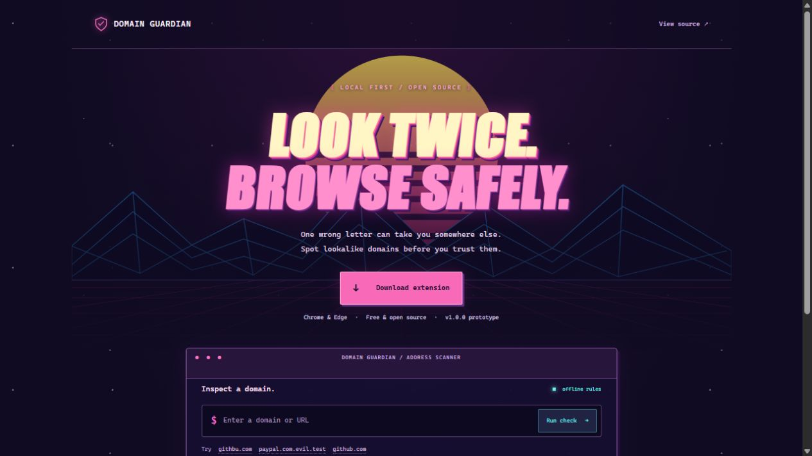

# Domain Guardian

[](https://domain-guardian-maytham.maythamlucky.chatgpt.site/)

A privacy-first Chrome / Edge extension that flags domains resembling trusted sites. Built with JavaScript and Manifest V3, with no runtime dependencies or external lookup service.

[Try the live domain checker](https://domain-guardian-maytham.maythamlucky.chatgpt.site/) · [Download the extension ZIP](https://domain-guardian-maytham.maythamlucky.chatgpt.site/domain-guardian-extension.zip)

## Try it

Enter `githbu.com` in the website checker to see why a two-letter swap resembles `github.com`. The checker runs locally and never opens the submitted address.

## Install on desktop Chrome or Edge

1. Download and extract the extension ZIP above.
2. Open `chrome://extensions` or `edge://extensions` and enable **Developer mode**.
3. Choose **Load unpacked** and select the extracted **extension** folder containing `manifest.json`.
4. Pin **Domain Guardian** from the extensions menu. Add domains you have independently verified in its popup.

The ZIP is free to download and install manually. This prototype has no Chrome Web Store listing.

## Features

- Single-edit misspellings and adjacent letter swaps: `githbu.com` resembles `github.com`.
- Selected visual substitutions: `g00gle.com` resembles `google.com`.
- Embedded protected domains: `paypal.com.evil.test` is not `paypal.com`.
- Brand-bearing labels and changed suffixes.
- Generic Punycode / internationalized-domain caution.
- Custom protected domains, saved on the device, with add/remove controls.
- Toolbar status and a dedicated warning page with a protected-domain link.
- All URL analysis happens locally. No analytics or network requests.

The initial protected list contains 15 commonly used domains. It is a demonstration list, not a complete or independently audited legitimacy database. Verify custom entries independently.

## Safety model and limits

This tool identifies suspicious resemblance; it cannot establish malicious intent or certify legitimacy. Unknown domains are labeled unknown. A protected-domain match includes all subdomains and does not verify site content, ownership, redirects, or whether an account/subdomain has been compromised. Suggested links go to the configured protected domain root, not a reconstructed login page.

Warnings run on `webNavigation.onCommitted`, **after navigation has begun**. They are not a network firewall or guaranteed pre-load blocker: the destination can receive a request and may execute content before redirection. Same-document URL changes are not rechecked. The project does not inspect content, certificates, reputation feeds, email links, DNS, or downloads.

Detection compares suffix labels against configured full domains rather than attempting a complete Public Suffix List implementation. It does not claim to identify the registrable domain of every hostname. Unicode names receive a general Punycode caution, not comprehensive Unicode confusable analysis. Multi-edit typos, brand variants, and unrelated phishing domains can be missed. Legitimate names may trigger warnings.

The warning deliberately discards the original URL path and query. For a false positive, users can disable the extension in their browser manager for that visit. No bypass or allowlist is included in this prototype.

## Permissions and privacy

`webNavigation` observes main-frame navigation URLs; `tabs` reads the active/current URL and redirects or closes the affected tab; `storage` saves user-configured domains locally. No host permissions, content scripts, remote code, analytics, or external reputation requests are used. Browser access warnings reflect the ability to see navigation URLs even though they are not transmitted or logged by the extension.

Only custom domains persist in `chrome.storage.local`. A warning page URL contains the flagged hostname. Original paths, queries and credentials are not stored. See [PRIVACY.md](PRIVACY.md).

## Development and verification

Install Node.js 24 or newer, then run:

```sh
npm test
npm run check
```

Node's built-in test runner covers typo detection, deception, URL parsing, custom domains, and a mocked browser navigation flow. GitHub Actions runs these checks on push and pull request. No dependency installation is necessary.

Manual browser acceptance checklist (not yet executed):

1. Load unpacked and check for extension errors.
2. Open a normal protected site and verify the `OK` badge.
3. Use **Check without visiting** with `githbu.com`, `paypal.com.evil.test`, and an unknown `.test` name; check explanations and suggested links.
4. Add/remove `school.ac.uk`, close/reopen the popup, and confirm persistence.
5. For automatic warning tests, navigate to an isolated local test server using a hosts-file mapping for a synthetic typo of a custom protected `.test` domain. Do not visit real suspicious sites.
6. Verify keyboard navigation, narrow popup layout, warning tab close, service-worker restart, and multiple rapid navigations.

## Architecture

`detector.js` is a pure rule engine using WHATWG URL normalization and Damerau-style edit distance. `background.js` handles top-level navigation and ignores stale URL results. `ui.js` renders popup/warning output with text nodes, avoiding HTML injection. Popup checks never navigate to supplied URLs.

## Next steps

Complete real-browser acceptance tests; add a safe per-tab bypass; evaluate against labeled benign/malicious datasets; support public-suffix and Unicode confusable data; then prepare icons, screenshots, store disclosures, and a reviewed release for public distribution.

## References

- [Chrome extension service workers](https://developer.chrome.com/docs/extensions/develop/concepts/service-workers/basics)
- [Chrome permission declarations](https://developer.chrome.com/docs/extensions/develop/concepts/declare-permissions)
- [Chrome webNavigation API](https://developer.chrome.com/docs/extensions/reference/api/webNavigation)

MIT licensed.
